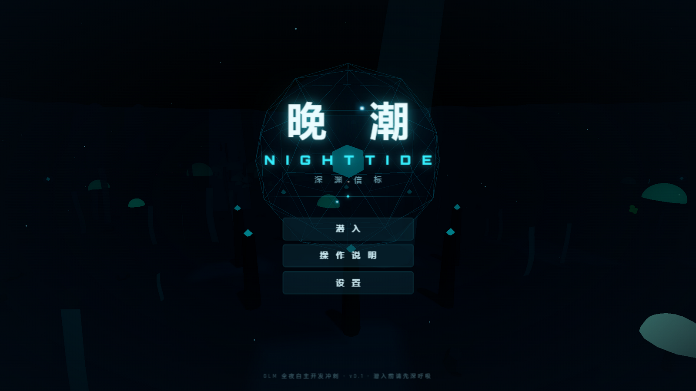

# 晚潮 NIGHTTIDE · 深渊信标

> 第三人称深海探索潜行 3D 游戏 · Three.js 垂直切片
> 一次"全夜自主开发冲刺"的完整交付(2026-10-24)

**你是海沟深处的守灯人。三座信标都熄灭了,深渊守卫在黑暗中巡游。
收集光晶,修复信标,在被它看见之前。**



## 快速开始

```bash
npm install      # 安装依赖(three + vite + 本地字体)
npm run dev      # 开发服务器 → http://127.0.0.1:5180
npm run build    # 生产构建 → dist/
npm run preview  # 预览生产构建
npm test         # 33 个 SIM 层单元测试(node --test)
```

环境要求:Node ≥ 20(建议 24),现代浏览器(Chrome/Edge/Firefox),无需 GPU 独显(集成显卡可跑)。

## 玩法

| 键 | 动作 |
|---|---|
| W A S D | 游动(相对相机方向) |
| SPACE / C | 上浮 / 下潜 |
| SHIFT | 冲刺(更快,但耗氧翻倍且极易被守卫察觉) |
| E | 按住 3 秒修复信标 / 唤醒核心 |
| ESC | 暂停 |
| 鼠标 | 视角(点击画面锁定指针) |

**核心循环**:探索海沟 → 收集光晶(◇) → 修复三座信标(各耗 4 枚,按住 E 引导 3 秒)→ 中央穹顶解锁 → 唤醒核心 → 结算。

**生存规则**:
- 氧气=生命。常态缓慢消耗,冲刺加倍,被咬 -26;发光的**氧藻丛**附近自动回充。
- **深渊守卫**(品红眼睛的巨型鳗)循光而来:头灯越亮、动静越大,它感知越远;静止+低灯时只有 6.5m 感知。冲刺噪音 42m 内会把它引来。
- 信标点亮范围是安全区——守卫不敢进入(战术:点亮信标开路)。
- 被咬后守卫会短暂撤离,趁机逃进氧藻或安全区。

**地图**:海沟式碗状地形,五大区域——南口残骸带(出生)→ 西侧荧光林谷 / 东侧断裂管道区 / 北侧废墟塔群(三信标)→ 中央穹顶(核心)。14 枚光晶(需求 12,有探索容错),6 处氧藻丛。

## 技术栈与架构

- **Three.js 0.180** + Vite 7,纯 ESM,零外部素材(全部程序化:模型/地形/材质/动画/音效)。
- 后期链:EffectComposer + UnrealBloom(高画质档)+ ACES 色调映射。
- **SIM/VIEW 分层**:纯逻辑层(状态机/氧气/任务/AI 决策)不依赖 three.js,可直接 node 单测;渲染层只消费逻辑层输出。

```
src/
  main.js               装配与主循环(rAF + 看门狗双驱动)
  core/                 EventBus · RNG(种子噪声) · GameState · Input · SaveSystem
  sim/                  OxygenSystem · Objectives · PredatorBrain(纯逻辑,可测)
  data/WorldData.js     关卡布局单一事实来源
  render/               App3D(渲染器/后期) · Terrain(解析高度场) · Environment(设施/信标)
                        Flora(荧光蘑菇/氧藻/水母/海草) · Particles(微尘/孢子/气泡)
                        FishSchools(boids) · DiverModel(程序动画) · PredatorModel(节链鳗)
  game/                 Player(水中物理) · CameraRig · Gameplay(交互组装)
  ui/                   UIManager(DOM 全套界面) · style.css
  audio/AudioSystem.js  WebAudio 程序化音效(环境/声纳/心跳/低吼/琶音)
tests/                  33 个 node:test 单元测试
screenshots/            实机截图
docs/                   设计与架构细节
```

详见 [docs/DESIGN.md](docs/DESIGN.md)(玩法与关卡设计)与 [docs/ARCHITECTURE.md](docs/ARCHITECTURE.md)(模块与扩展指南)。

## 已验证清单(实测)

- [x] 标题→潜入→HUD 全链路,控制台零报错
- [x] WASD 游动/冲刺/上下浮(水中阻尼手感),深度表实时变化
- [x] 光晶磁吸收集(实测 12/12)
- [x] 三座信标按住 E 修复(实测 3/3),点亮后光柱+光圈+罗盘点亮
- [x] 核心解锁→唤醒→胜利结算(统计正确)
- [x] 氧气耗尽→失败结算;被咬→氧气-26→守卫撤离
- [x] 守卫 AI 全状态链:巡逻→(被声/光吸引)调查→追击→扑咬→撤离;信标安全区放弃追击
- [x] 暂停/恢复/重开(状态无残留)/设置(音量/灵敏度/画质档)/帮助
- [x] 终局演出:核心苏醒相机环绕 + 铭文字幕 → 结算(实测全流程)
- [x] 守卫接近恐惧反馈(品红边缘脉动)、罗盘距离角标、暂停景深模糊
- [x] 33/33 单元测试通过(含演出迭代后回归)
- [x] 帧率:gameplay 时间与真实时间 1.001:1(满实时,含 bloom 高档)
- [x] 视觉验收:4 张实机截图(过曝与角色不可见问题已在迭代中修复)

## 已知问题与边界

1. **Pointer Lock 需真实手势**:部分嵌入式 webview 无手势时锁鼠标会失败(已静默兜底,键盘仍可玩);桌面 Chrome/Edge 正常。
2. **rAF 后台暂停**:某些 webview 可见但失焦时暂停 requestAnimationFrame——已内置看门狗自动降级 setTimeout 驱动。
3. 掠食者身体节链在急转弯时偶发轻微穿插(视觉瑕疵,不影响玩法)。
4. 未做移动端触控(目标平台为桌面浏览器)。
5. 音频为全程序化合成,主观听感因设备而异;音量可在设置中分别调节。

## 许可

代码:MIT。全部资产(模型/材质/音效/字体)为程序化生成或本地打包的开源字体(Orbitron/Rajdhani,SIL OFL),无第三方版权素材。
